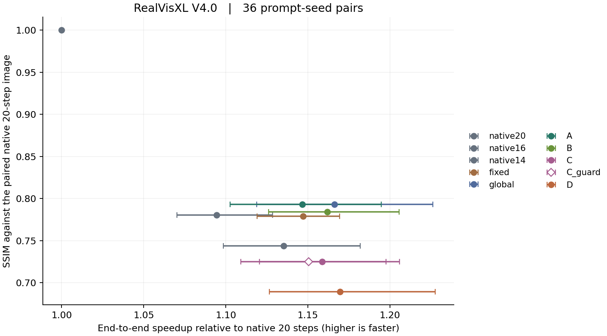
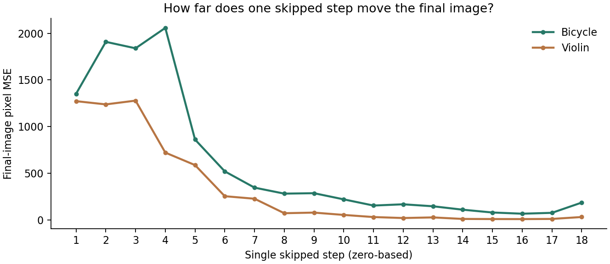
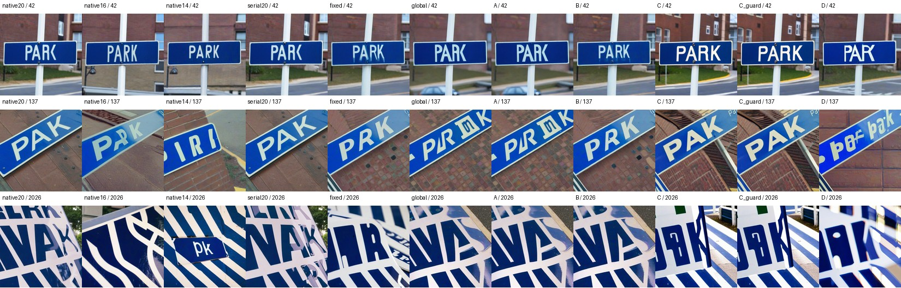

# RealVisXL 文生图缓存对照实验

我们想知道，同样花六七秒出一张图，把模型少跑几步，还是保留原来的采样步数、只在必要时重算，更能保住画面？用 RealVisXL V4.0 测了 12 条提示词和 3 个随机种子，每个组合各跑 11 种设置，共 396 张测试图。

[课堂汇报 PPT（10 页，附讲稿）](RealVisXL缓存评测.pptx) · [逐提示词对比图](grids) · [全部 396 张 JPEG（按提示词下载）](samples) · [图像实验复现](../README.md) · [Wan 视频复验](../../Wan2.1/BENCHMARK.md)

## 本机测到了什么

原生 20 步每张平均 8.04 秒。直接减到 14 步，平均 7.08 秒，SSIM 为 0.744。保留 20 个采样位置、其中 6 个复用旧输出时，固定跳步为 7.01 秒、SSIM 0.779。两种方案都实际计算了 28 个 U-Net 分支。SSIM 越高，说明生成的构图和纹理越接近同种子的原生 20 步图。

**方向 D 是我重点做的部分。** 在相同的固定跳步上，加一个“只算带提示词的分支”的档位，真实分支由 28 个降到平均 20.1 个。耗时从 7.01 变成 6.87 秒，SSIM 从 0.779 变成 0.689。原生管线会把两个分支一起算，整次出图还要编码提示词和解码图像，所以分支数和端到端耗时必须分别测。

这批图上，只看全局变化来选步就能做到 6.89 秒、SSIM 0.793。A 和 B 增加了选步依据，平均保真度分别为 0.793 和 0.784。D 比固定跳步平均快约 0.14 秒，差距落在本机的计时波动里。搬到 Wan 上最值得验证的是，视频模型逐条执行 CFG 分支时，省下的那条分支能不能带来更明显的提速。

## 全部结果

每行 36 张图。计时从预热后的管线调用开始，到图像解码完成为止。加速比取原生 20 步平均耗时除以该设置平均耗时。括号内为按提示词成组抽样 5,000 次得到的 95% 区间。CLIP 看整句话与图片是否匹配；DINO 看指定主体短语能否被检测到。后二者都是相似度或置信度分数。

| 设置 | 分支/图 | 秒/图 | 加速比（95% 区间） | SSIM | PSNR (dB) | CLIP 余弦 | DINO 主体 |
|---|---:|---:|---:|---:|---:|---:|---:|
| native20 | 40.0 | 8.04 | 1.00× (1.00–1.00) | 1.000 | ∞ | 0.348 | 0.834 |
| native16 | 32.0 | 7.34 | 1.09× (1.07–1.13) | 0.781 | 21.28 | 0.347 | 0.815 |
| native14 | 28.0 | 7.08 | 1.14× (1.10–1.18) | 0.744 | 19.74 | 0.349 | 0.831 |
| serial20 | 40.0 | 9.51 | 0.84× (0.80–0.89) | 0.979 | 41.01 | 0.347 | 0.822 |
| fixed | 28.0 | 7.01 | 1.15× (1.12–1.17) | 0.779 | 21.34 | 0.345 | 0.795 |
| global | 28.0 | 6.89 | 1.17× (1.12–1.23) | 0.793 | 21.72 | 0.347 | 0.817 |
| A | 28.0 | 7.01 | 1.15× (1.10–1.19) | 0.793 | 21.98 | 0.347 | 0.822 |
| B | 28.0 | 6.92 | 1.16× (1.13–1.21) | 0.784 | 21.62 | 0.348 | 0.829 |
| C | 28.0 | 6.93 | 1.16× (1.12–1.21) | 0.725 | 18.79 | 0.347 | 0.807 |
| C_guard | 28.0 | 6.99 | 1.15× (1.11–1.20) | 0.725 | 18.79 | 0.347 | 0.807 |
| D | 20.1 | 6.87 | 1.17× (1.13–1.23) | 0.689 | 17.74 | 0.347 | 0.807 |

RTX 5070 Laptop，8 GB 显存，512×512，Euler，CFG 6，FP16，按组件卸载。各设置平均峰值已分配显存在 4.96–4.98 GiB 之间。SSIM、PSNR 用原始 PNG 计算。参考图与自身相同，PSNR 为无穷大。[环境](environment.json) · [汇总](summary.json) · [逐图指标、耗时与每步动作](runs.json)

## 相同计算预算下，四个想法分别怎样

- **A · 把变化最大的局部区域加入评分。** 与只看全局变化相比，36 对图有 24 对选择了完全相同的重算位置。A 的 SSIM 在 7 对上更高，24 对持平，平均变化 -0.0001。

- **B · 优先照顾跳错后最影响最终成图的步骤。** 与只看全局变化相比，36 对图有 2 对选择了完全相同的重算位置。B 的 SSIM 在 15 对上更高，2 对持平，平均变化 -0.0093。

- **C · 用前两次输出外推。** 与相同位置的固定复用相比，平均 SSIM 变化 -0.0538。开启回退保护后，216 次候选外推中有 0 次退回旧输出。

- **D · 只重算条件分支。** 36 张图共有 284 个单算步。以固定跳步为基线，再加 D 的端到端加速比是 1.02×（配对 95% 区间 0.979–1.066）。与原生 20 步比较的总加速比为 1.17×。前者衡量 D 自己多省了多少，后者还包含固定跳步的收益。

## 用额外实验检查这组结论

**跳错哪一步最贵？** 单独用两条校准提示词，各做 18 次单步干预和一次全算。合计耗时 319 秒。候选步前六步的最终像素均方差，是后六步的 18.5 倍。这是 B 的权重来源。[每次干预的原始值](calibration.json)

在另外 12 条测试提示词上，每条取种子 42，保留整条全算轨迹。把“用旧引导输出会产生的单步误差”排序，检查各分数在误差最大的 6 步中找对几个。即使眼下输出偏得少，这个误差仍可能在后续采样中放大，所以这项诊断与 B 的最终图像干预有不同含义。[逐步记录](step_audit.json)

| 选步分数 | 平均找对（共 6 步） | 平均 Spearman 秩相关 |
|---|---:|---:|
| 全局变化 | 3.17 | 0.322 |
| A 局部变化 | 3.33 | 0.407 |
| B 影响加权 | 3.08 | 0.082 |

**同一张图的计时会波动多少？** 森林跑车、种子 42，五种方法轮换先后顺序，各重复五次。下表是秒数。这组复测可以判断，两个设置快慢只差零点几秒时，差距相对于本机波动有多大。[原始计时](repeat.json)

| 设置 | 最短 | 中位数 | 最长 |
|---|---:|---:|---:|
| B | 6.11 | 6.15 | 6.96 |
| D | 5.91 | 6.15 | 6.36 |
| fixed | 6.04 | 6.37 | 6.94 |
| native14 | 5.98 | 6.39 | 6.91 |
| native20 | 7.04 | 7.44 | 8.56 |

**主体能认出来，具体要求做到了吗？** 挑了三条能逐项核对的提示词，混排图片并隐藏方法名，由一个视觉模型按固定规则逐张判读。下表是通过张数，每格共 3 张。杯子要求恰好两个蓝杯、右杯白把手；路牌要求蓝底白字、四个字母清楚拼出 PARK；积木要求恰好三块，从左到右红、绿、蓝。单一评阅者、每种设置 9 张细节图，适合定位哪些要求容易失败。[99 张逐图判定](detail.json)

| 设置 | 杯子 | PARK 路牌 | 积木 | 合计 / 9 |
|---|---:|---:|---:|---:|
| native20 | 2 | 0 | 0 | 2 |
| native16 | 1 | 1 | 0 | 2 |
| native14 | 1 | 1 | 0 | 2 |
| serial20 | 2 | 0 | 0 | 2 |
| fixed | 2 | 1 | 0 | 3 |
| global | 1 | 0 | 0 | 1 |
| A | 1 | 0 | 0 | 1 |
| B | 1 | 1 | 0 | 2 |
| C | 0 | 1 | 0 | 1 |
| C_guard | 0 | 1 | 0 | 1 |
| D | 0 | 0 | 0 | 0 |

例如路牌提示词、种子 137，原生 20 步已经把 PARK 写成了 PAK，B 和 D 生成的牌子也有缺字或错字。这个例子说明，画面接近参考图与正确完成文字要求，是两件都值得检查的事。

## 队友怎样接着做

Wan 入口先跑三段同种子视频：每步全算、小组原版 SenCache、原版选步加 D。后两段使用相同的刷新位置，最适合看 D 在视频模型上能多省多少时间。完整模式可在 Wan 上重新校准 A/B，复验 C/D，再比较直接减到 14 步。这里报告的 396 张图均来自 RealVisXL；Wan 适配用缩小的官方网络检查了真实主干调用次数，预训练 1.3B 的视频结果留给组里已有的环境测。[视频运行说明](../../Wan2.1/BENCHMARK.md) · [配对统计](comparisons.json)
